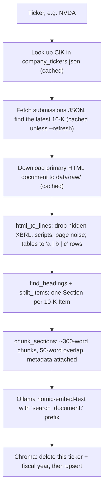
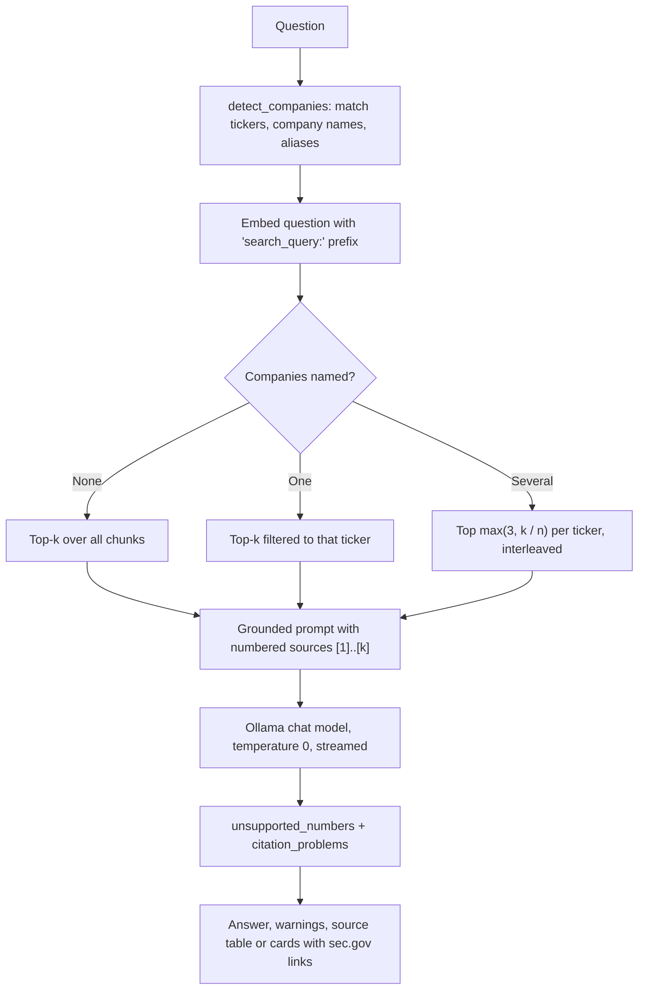
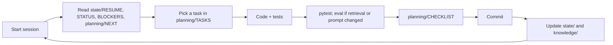

# Flow

How data and work move through the project. For component design see
[`architecture/ARCHITECTURE.md`](architecture/ARCHITECTURE.md).

## 1. Ingest flow (`edgar-rag ingest`)

Per ticker, the CLI prints a summary row: company, fiscal year, filing date, number of Items,
number of chunks and seconds taken.

## 2. Question flow (`edgar-rag ask` and the Streamlit UI)

In the UI, the sidebar multiselect overrides automatic company detection, and the slider sets k.

## 3. Evaluation flow (`edgar-rag eval`)

1. Load labeled cases from `eval/questions.yaml` (question, ticker, acceptable Items, optional evidence).
2. Retrieve top-k for each question (company filter on, or off with `--no-company-filter`).
3. Record the rank of the first chunk from the right section and the first chunk containing the evidence.
4. Summarize section hit rate@k, MRR and evidence hit rate@k.
5. With `--answers`, generate every answer and run both checks.
6. With `--output`, write a Markdown report (see `eval/reports/`).

## 4. Work flow (people and agents)

The detailed protocol is in [`AGENTS.md`](AGENTS.md).
