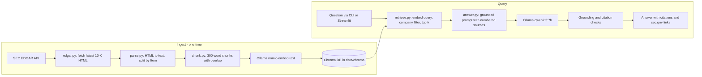

<p align="center">
  
</p>

<h1 align="center">edgar-rag</h1>

<p align="center">
  <strong>A local RAG assistant over SEC 10-K filings, with answers that cite their sources.</strong>
</p>

<p align="center">
  
  
  
  
  
</p>

Ask questions about real annual reports (Form 10-K) from Apple, Microsoft and NVIDIA and get
answers that cite the exact filing section they came from, with a link to the original document on
sec.gov. Everything runs on your machine: [Ollama](https://ollama.com) serves the models and
[Chroma](https://www.trychroma.com) stores the vectors. No API keys, no data leaves your laptop.

```text
$ uv run edgar-rag ask "How many employees does NVIDIA have?"
Filtered to: NVDA

As of the end of fiscal year 2026, NVIDIA had approximately 42,000 employees in 38 countries [6].

Sources
 # | Section                                                | Filing
 1 | NVIDIA CORP (NVDA) 10-K FY2026, Item 1: Business       | https://www.sec.gov/Archives/edgar/data/1045810/...
 ...
```

## Why this project is interesting

- **Real, messy data.** Filings come straight from the SEC EDGAR API as large HTML documents with
  inline XBRL, split-span headings (`ITEM 1A. RIS` + `K FACTORS`), running page headers, and
  financial tables where `$` and `%` live in separate cells. The parser handles all of these.
- **Structure-aware chunks.** Text is split by 10-K Item (1 Business, 1A Risk Factors, 7 MD&A,
  8 Financial Statements, ...) before chunking, so every answer can cite e.g. *Item 1A: Risk Factors*.
- **Measured, not guessed.** A labeled eval set (24 questions) scores retrieval at two levels of
  strictness, and the chunk size and chat model defaults were chosen from those numbers.
- **Guardrails for small models.** 7-8B local models occasionally invent or "convert" figures.
  Every answer is checked automatically: numbers that don't appear in the retrieved sources and
  missing or invalid citations are flagged in both the CLI and the UI.

## Architecture



| Module | Responsibility |
|---|---|
| [`edgar.py`](src/edgar_rag/edgar.py) | Ticker to CIK lookup, latest 10-K discovery, cached and rate-limited downloads (SEC requires a `User-Agent` and at most 10 requests/s) |
| [`parse.py`](src/edgar_rag/parse.py) | HTML to clean lines (tables become `a \| b \| c` rows with units re-attached), Item heading detection that skips the table of contents |
| [`chunk.py`](src/edgar_rag/chunk.py) | Paragraph-aware chunking with overlap; each chunk carries ticker, company, fiscal year, Item, title and filing URL |
| [`index.py`](src/edgar_rag/index.py) | Batch embeddings through Ollama (with nomic's `search_document:` / `search_query:` prefixes), idempotent upsert into Chroma |
| [`retrieve.py`](src/edgar_rag/retrieve.py) | Detects companies named in the question and filters by them; comparison questions retrieve per company and interleave |
| [`answer.py`](src/edgar_rag/answer.py) | Grounded prompt, streaming generation, numeric grounding check, citation check |
| [`evaluate.py`](src/edgar_rag/evaluate.py) | Section-level and evidence-level retrieval metrics |
| [`cli.py`](src/edgar_rag/cli.py) / [`app.py`](app.py) | `edgar-rag ingest \| ask \| eval` and the Streamlit chat UI |

No LangChain or LlamaIndex: each step is a small, readable function.

## Setup

Requirements: macOS or Linux, [Homebrew](https://brew.sh) (or install `uv` and Ollama another way),
about 6 GB of disk for the models. Tested on an Apple M4 Pro with 24 GB RAM.

```bash
git clone https://github.com/sparkk29/edgar-rag-ollama.git
cd edgar-rag-ollama

brew install uv ollama
brew services start ollama
ollama pull qwen2.5:7b && ollama pull nomic-embed-text

uv sync                       # creates .venv with Python 3.12 and all dependencies
cp .env.example .env          # then set SEC_USER_AGENT="Your Name you@example.com"
```

The SEC asks every client to identify itself; requests without a real name and email in the
`User-Agent` header get blocked.

Run all commands from the repository root (the folder containing `pyproject.toml`); `uv sync` fails
with "No `pyproject.toml` found" anywhere else. To use `llama3.1:8b` instead of the default chat
model, pull it and set `EDGAR_RAG_CHAT_MODEL=llama3.1:8b` in `.env`.

## Usage

```bash
# Download, parse, chunk, embed and index the latest 10-K of each company (~30 s)
uv run edgar-rag ingest
uv run edgar-rag ingest --tickers AMZN,GOOGL   # any SEC-registered ticker works
uv run edgar-rag ingest --refresh              # re-check EDGAR for newer filings

# Ask questions
uv run edgar-rag ask "What supply chain risks does NVIDIA disclose?"
uv run edgar-rag ask "Compare Apple's and Microsoft's revenue drivers." --show-context

# Chat UI at http://localhost:8501
uv run streamlit run app.py

# Evaluate
uv run edgar-rag eval                          # retrieval metrics only (seconds)
uv run edgar-rag eval --no-company-filter      # ablation: pure semantic search
uv run edgar-rag eval --answers --output eval/reports/run.md   # also generate + check answers (~6 min)

# Unit tests
uv run pytest
```

All settings (tickers, models, chunk size, top-k, context window) can be overridden through
environment variables; see [`.env.example`](.env.example) and [`config.py`](src/edgar_rag/config.py).

The Streamlit UI has example questions, a k slider, an optional company filter, and expandable
source cards with the retrieved text and a link to the filing.

## Example answers

Generated by `qwen2.5:7b` with the default settings. Full transcripts for all 24 eval questions are
in [`eval/reports/`](eval/reports/).

**What does NVIDIA say about customer concentration and its largest direct customers?**

> NVIDIA Corporation indicates that its revenue is concentrated among a limited number of direct
> and indirect customers, and this trend may continue. Specifically, for fiscal year 2026, sales to
> one direct customer represented 22% of total revenue, and sales to another direct customer
> represented 14% of total revenue, both primarily attributable to the Compute & Networking
> segment [1][2]. ...

**What is the nature of Microsoft's partnership and investment in OpenAI?**

> ... Microsoft is a major investor in OpenAI, holding an approximate 25% interest on an
> as-converted basis [1]. This investment is accounted for under the equity method, and Microsoft
> has made total funding commitments of $13.0 billion, of which $11.9 billion has been funded as of
> June 30, 2026 [1]. ...

**What was Tesla's revenue last year?** (Tesla is not indexed)

> Not found in the indexed filings.

**The grounding check in action.** Asked to compare Apple's and Microsoft's revenue drivers, the
model wrote that Services were "26.5% of total net sales". The filing only gives dollar amounts
(Services $109,158M of $416,161M total, which is 26.2%), so the model did its own arithmetic and got it
wrong. The check caught it:

```text
Grounding check: these figures were not found in the sources: 26.5, 24.4, 22.2
```

## Evaluation

[`eval/questions.yaml`](eval/questions.yaml) holds 24 questions across the three filings. 14 name
the company and topic directly; 10 are harder (the company is not named, e.g. *"Which company is
headquartered in Santa Clara?"*, or the answer sits in a less obvious section such as Item 9B
insider trading plans). Each is labeled with:

- **Expected section(s)**: ticker plus acceptable 10-K Items. Section hit rate@k and MRR measure
  whether a chunk from the right section is retrieved and how high it ranks.
- **Evidence string** (20 of 24): a fact that must appear verbatim in a retrieved chunk, such as
  `42,000 employees`. This is the stricter metric, because a section can be huge (Microsoft's Item 8
  is more than 17,000 words), so retrieving *some* chunk from Item 8 doesn't mean the answer was retrieved.

### Retrieval

| Chunk size | k | Section hit rate | Section MRR | Evidence hit rate |
|---|---|---|---|---|
| 600 words (287 chunks) | 3 | 100% | 1.000 | 90% |
| 600 words | 6 | 100% | 1.000 | 95% |
| 300 words (572 chunks) | 3 | 100% | 1.000 | 85% |
| **300 words (default)** | **6** | **100%** | **1.000** | **100%** |

Takeaways:

- Section-level retrieval is easy at this scale (3 filings): even with the company filter disabled
  (`--no-company-filter`), every question's top hit comes from the correct company and Item. The
  company name in each chunk's embedding header does most of that work.
- The evidence metric is what moved. With 600-word chunks, the "Human Capital Management"
  paragraph containing NVIDIA's headcount was diluted inside a long Business chunk and never reached
  the top 6, so the model answered "Not found". Halving the chunk size fixed this and also halved
  the prompt size, which made generation faster.

### Answers (k=6, 300-word chunks, 24 questions)

| Chat model | Answers with ungrounded figures | Answers with citation problems | Time for 24 answers |
|---|---|---|---|
| **`qwen2.5:7b` (default)** | 1/24 | 0/24 | 313 s (about 13 s each) |
| `llama3.1:8b` | 2/24 | 0/24 | 324 s |

What the flagged answers were (full text in [`eval/reports/`](eval/reports/)):

- **qwen2.5:7b** split Microsoft's "$10.2 billion returned in Q4" into "$6.759 billion in dividends
  and $3.451 billion in share repurchases". The dividend is a unit conversion of the filing's
  $6,759 million; the buyback figure is made up (10.2 - 6.759 would be 3.441).
- **llama3.1:8b** computed NVIDIA's Data Center growth ($78,551 million; correct arithmetic, but
  not stated in the filing) and added dividends and buybacks from two different fiscal years into
  a misleading "$56.7 billion" total.

Both models answered all 20 evidence questions with the right figure. qwen2.5 was chosen as the
default because its answers were more complete (e.g. it reported the 25% OpenAI stake and
funding figures that llama left out) and slightly faster. In an early run, before the prompt
forbade calculations, llama3.1 invented three Microsoft product-revenue figures outright, which is
what motivated the grounding check.

The automatic checks catch a specific failure mode, not every error. They flag numbers absent
from the sources (typically arithmetic or unit conversions the model did on its own) and missing or
out-of-range citations. They cannot detect a real number attached to the wrong claim. For that, read
the cited source cards, which is exactly what the UI is designed for.

## Limitations

- **One filing per company.** Only the most recent 10-K is indexed, so year-over-year questions are
  limited to the comparisons the filing itself contains (usually 2-3 years in tables).
- **Company detection is a keyword match** on ticker, the first word of the SEC company name and a
  few aliases. A question like "the iPhone maker's risks" works only because of a hand-written alias.
- **Tables are flattened** to `label | 2025 | 2024` rows. Good enough for lookups, but the model
  sometimes misreads which column is which year.
- **Small local models.** A 7B model is fast and private but weaker at multi-step reasoning and
  arithmetic than frontier models; the checks above mitigate but don't eliminate this. Minor quirks
  also show up, such as appending "Not found in the indexed filings." after an otherwise complete
  answer.
- **The eval set is small and author-labeled** (24 questions), so treat the numbers as a regression
  test rather than a benchmark.

## Next steps

- Hybrid search: add BM25 next to dense retrieval for exact terms and figures.
- A cross-encoder reranker over the top 20 candidates.
- Parse financial tables into structured data (XBRL facts) so numeric questions are answered from
  data instead of text.
- Index several fiscal years per company and add a fiscal-year filter.
- LLM-as-judge answer scoring to complement the rule-based checks.

## Project documentation

Beyond this README, the project keeps its plans, current state and lessons in Markdown so that
people and AI coding agents can pick up work quickly. Start with [`AGENTS.md`](AGENTS.md).

| Where | What you will find |
|---|---|
| [`AGENTS.md`](AGENTS.md), [`RULES.md`](RULES.md) | How to work on the project and the rules that must not be broken |
| [`PROJECT_CONTEXT.md`](PROJECT_CONTEXT.md), [`REQUIREMENTS.md`](REQUIREMENTS.md), [`FLOW.md`](FLOW.md) | What it is and why, requirements and acceptance criteria, ingest/query/eval flows |
| [`planning/`](planning/) | [Plan](planning/PLAN.md), [tasks](planning/TASKS.md), [next steps](planning/NEXT.md), [checklists](planning/CHECKLIST.md), [roadmap](planning/ROADMAP.md) |
| [`state/`](state/) | [Status](state/STATUS.md), [progress log](state/PROGRESS.md), [session notes](state/SESSION.md), [resume point](state/RESUME.md), [handoff](state/HANDOFF.md), [blockers](state/BLOCKERS.md) |
| [`architecture/`](architecture/) | [Architecture](architecture/ARCHITECTURE.md), [tech stack](architecture/TECH_STACK.md), [CLI and Python API](architecture/API.md), [vector store schema](architecture/DATABASE.md), [decision records](architecture/DECISIONS.md) |
| [`quality/`](quality/) | [Coding standards](quality/CODING_STANDARDS.md), [testing](quality/TESTING.md), [review checklist](quality/REVIEW.md), [end-to-end validation](quality/VALIDATION.md), [security](quality/SECURITY.md) |
| [`knowledge/`](knowledge/) | [Key facts](knowledge/MEMORY.md), [failures and fixes](knowledge/FAILURES.md), [debugging guide](knowledge/DEBUGGING.md), [experiments](knowledge/EXPERIMENTS.md), [risks](knowledge/RISKS.md) |

## Project layout

```text
.
├── app.py                    Streamlit chat UI
├── assets/                   logo (SVG source and PNG export)
├── eval/
│   ├── questions.yaml        labeled eval set
│   └── reports/              eval transcripts per chat model
├── src/edgar_rag/            the pipeline (see Architecture)
├── tests/                    unit tests with a small HTML fixture
├── data/                     downloaded filings + Chroma index (git-ignored)
├── AGENTS.md, RULES.md, ...  project docs (see Project documentation)
├── planning/ state/ architecture/ quality/ knowledge/
├── pyproject.toml
└── .env.example
```
