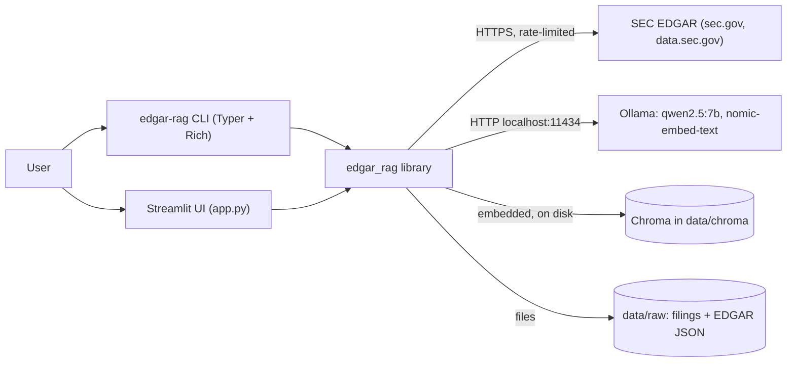

# Architecture

edgar-rag is a two-stage pipeline (ingest once, query many times) built from small modules with
one responsibility each. There is no framework and no server of our own: the CLI and the
Streamlit app call the same library functions, and Ollama and Chroma do the heavy lifting.

Step-by-step flows are in [`../FLOW.md`](../FLOW.md); the reasons behind each choice are in
[`DECISIONS.md`](DECISIONS.md).

## System context



## Modules

| Module | Responsibility | Depends on |
|---|---|---|
| `config.py` | `Settings` dataclass built from environment variables and `.env`; paths | `python-dotenv` |
| `edgar.py` | `EdgarClient`: ticker to CIK, latest 10-K, cached and throttled downloads; `Filing` | `httpx`, `config` |
| `parse.py` | `html_to_lines`, `find_headings`, `split_items`; `Section` | `beautifulsoup4`, `lxml` |
| `chunk.py` | `chunk_text`, `chunk_sections`; `Chunk` with metadata and embedding header | `parse` |
| `index.py` | Ollama client, `embed`, `embed_query`, `get_collection`, `index_chunks` | `ollama`, `chromadb`, `chunk`, `config` |
| `retrieve.py` | `company_aliases`, `detect_companies`, `retrieve`; `Hit` | `index`, `config` |
| `answer.py` | System prompt, `build_messages`, `stream_answer`, `unsupported_numbers`, `citation_problems` | `index`, `retrieve`, `config` |
| `evaluate.py` | `EvalCase`, `EvalResult`, `load_cases`, `evaluate_case`, `summarize` | `retrieve`, `pyyaml` |
| `cli.py` | `ingest`, `ask`, `eval` commands, Markdown report | everything above, imported lazily |
| `app.py` | Streamlit chat UI | `answer`, `retrieve`, `index`, `config` |

Dependencies point one way: `parse` and `chunk` know nothing about storage or models, which is why
they are fully unit-testable without Ollama or Chroma. `cli.py` imports pipeline modules inside each
command so `edgar-rag --help` starts instantly.

## Core data types

```text
Filing   ticker, company, cik, form, accession, filing_date, report_date, primary_document
         .fiscal_year (from report_date), .url (sec.gov archive link)
Section  item ("1A"), title ("Risk Factors"), text
Chunk    id ("NVDA-2026-1A-0003"), text, metadata{ticker, company, fiscal_year, filing_date,
         item, item_title, url, chunk_index}; .header, .embedding_text()
Hit      id, text, metadata, distance (cosine); .label for citations
EvalCase question, ticker, items[], evidence?
```

## Key mechanisms

**Parsing.** BeautifulSoup with lxml. Hidden inline-XBRL blocks (`ix:header`, `display:none`),
scripts and styles are removed. Each table becomes `a | b | c` rows, with `$`, `%` and `)` cells
glued back onto their numbers. Block elements become line breaks, which also re-joins headings that
filers split across spans. Page numbers, running headers and "Table of contents" lines are dropped.

**Item detection.** A regex finds lines like `Item 1A. Risk Factors`. Each heading appears at least
twice (table of contents, then the real section), so the last occurrence of each Item is kept, and
any Item that would break document order is discarded.

**Chunking.** Paragraphs are packed greedily up to 300 words; a paragraph longer than that is split
on sentences. Consecutive chunks share up to 50 words of trailing paragraphs. Sections under 15
words (e.g. "None.") are skipped. Each chunk's embedding text starts with a header such as
`NVIDIA CORP (NVDA) 10-K FY2026, Item 1: Business`, which makes chunks self-describing.

**Embedding.** `nomic-embed-text` through Ollama, with the `search_document:` and `search_query:`
task prefixes the model was trained with. Batches of 32.

**Indexing.** Before upserting a filing's chunks, all chunks with the same ticker and fiscal year
are deleted, so a re-parse that yields fewer chunks leaves no stale ones. See [`DATABASE.md`](DATABASE.md).

**Retrieval.** Companies named in the question restrict the search with a metadata filter. For
two or more companies, each is queried separately (`max(3, k // n)` hits each) and results are
interleaved by rank so every company is represented.

**Generation.** A system prompt requires source-only answers, `[n]` citations on every sentence,
figures copied exactly, no calculations, and an exact "not found" reply. Temperature 0,
`num_ctx` 16384, streamed token by token.

**Checks.** `unsupported_numbers` extracts every number of three or more significant characters
(ignoring years and `[n]` markers) and looks for it in the sources, ignoring thousands separators.
`citation_problems` flags answers without citations or with numbers outside `1..k`.

## Extension points

- New companies: `--tickers` or `EDGAR_RAG_TICKERS`; aliases in `retrieve.EXTRA_ALIASES`.
- Different models: `EDGAR_RAG_CHAT_MODEL`, `EDGAR_RAG_EMBED_MODEL` (re-ingest after changing embeddings).
- A reranker or hybrid search would slot into `retrieve.retrieve` without touching other modules.
- Several fiscal years: chunk IDs and the delete filter already include the fiscal year.
